# LAPORAN PRAKTIKUM PEMROGRAMAN BERBASIS OBJEK

| Informasi Praktikan | Keterangan |
| :--- | :--- |
| **Nama** | *Prevansyah Sjafar* |
| **NPM** | *4525210057* |
| **Kelas** | A |
| **Mata Kuliah** | Pemrograman Berbasis Objek (PBO) |
| **Pertemuan** | 07 - Relasi Objek dan UML Class Diagram |
| **Tanggal** | *Kamis 15 Oktober 2026* |
| **Dosen Pengampu** | *Adi Wahyu Pribadi, S.Si., M.Kom* |

---

## 1. Implementasi Java

### 1.1. File: `model/Buku.java`
**Penjelasan Kode:**
`Buku` punya `Bab`, dan `Bab` tidak bisa berdiri sendiri tanpa `Buku`. `Bab` dibuat di dalam `Buku` lewat `tambahBab(nomor, judul)`, bukan diterima dari luar. Constructor `Bab` dibuat `private`, jadi hanya `Buku` yang bisa membuatnya. Method `getBab()` mengembalikan salinan yang tidak bisa diubah (`List.copyOf`), sehingga isi bab tidak bisa dirusak dari luar. Constructor `Buku` juga menolak jumlah eksemplar yang negatif.

**Bukti Eksekusi (Screenshot):**
* **Before** *(Kondisi awal)*:

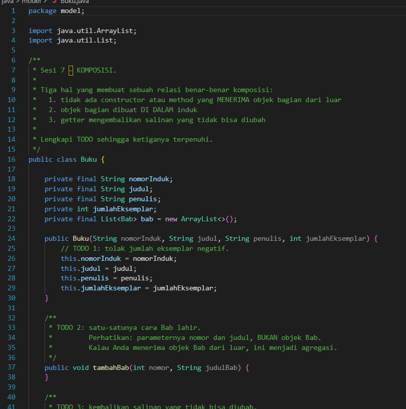

*Kondisi awal: semua TODO masih kosong.*

* **After** *(Kondisi akhir)*:

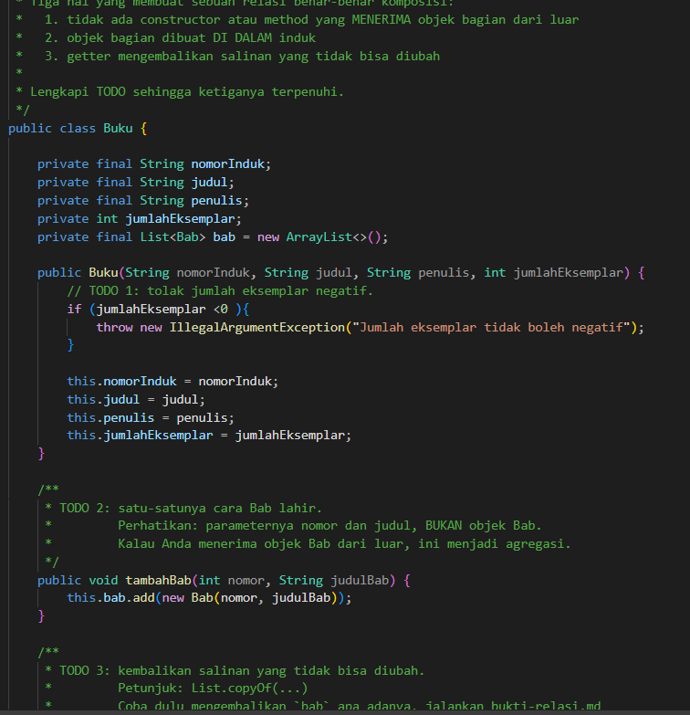

*Semua TODO sudah diisi.*

### 1.2. File: `model/Jurusan.java`
**Penjelasan Kode:**
 `Jurusan` berisi `Mahasiswa`, tetapi `Mahasiswa` dibuat di luar lalu dimasukkan lewat `daftarkan()`. Karena itu constructor `Mahasiswa` dibuat `public`, supaya bisa dibuat di mana saja. Method `daftarkan()` menolak `null` dan menolak NIM yang sudah terdaftar. Method `keluarkan()` hanya melepas mahasiswa dari jurusan, sedangkan objek mahasiswanya tetap ada.

**Bukti Eksekusi (Screenshot):**
* **Before** *(Kondisi awal)*:

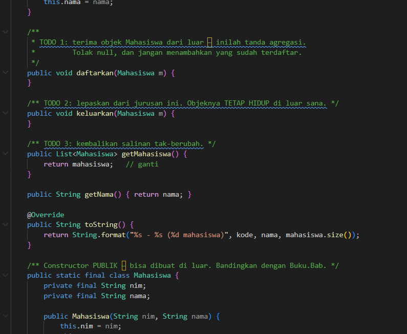

*Kondisi awal: method masih kosong (TODO).*

* **After** *(Kondisi akhir)*:

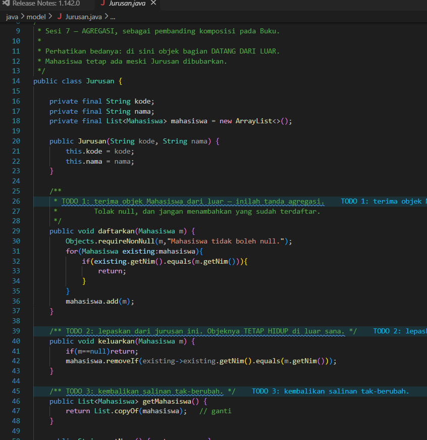

*Method sudah diisi.*

### 1.3. File: `service/PerpustakaanService.java`
**Penjelasan Kode:**
 `Buku`. Bukunya dibuat di luar lalu dimasukkan ke layanan, jadi hubungannya adalah **agregasi**. Method `tambahKoleksi()` menambah buku, tetapi menolak `null` dan nomor induk yang sama. Method `cariKoleksi()` mencari buku dari nomor induknya. Method `pinjam()` mengurangi stok buku, dan `kembalikan()` menambah stok lagi. Aturan yang lebih lengkap akan dibuat di pertemuan berikutnya.

**Bukti Eksekusi (Screenshot):**
* **Before** *(Kondisi awal)*:

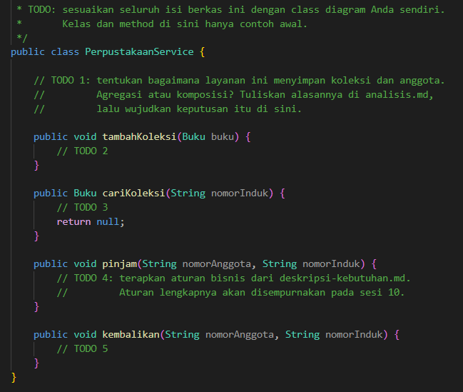

*Kondisi awal: method masih kosong (TODO).*

* **After** *(Kondisi akhir)*:

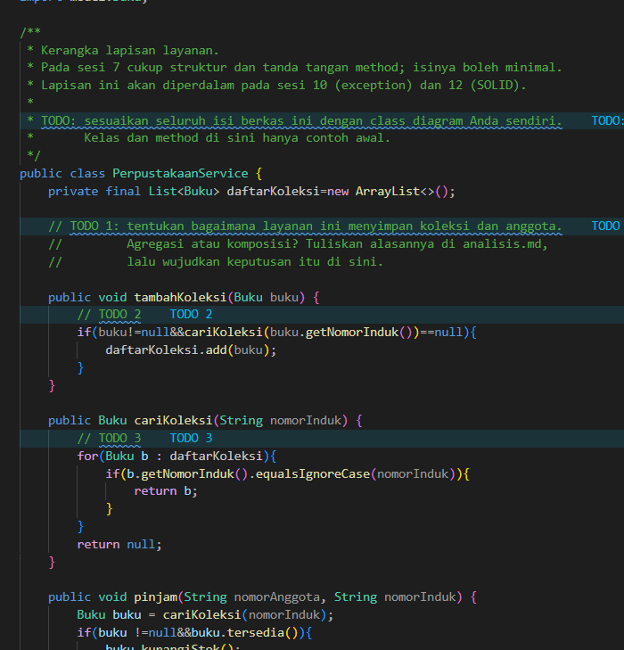

*Method sudah diisi dengan versi sederhana.*

### 1.4. File: `Main.java`
**Penjelasan Kode:**
 Bagian pertama membuat `Buku` dengan tiga bab, lalu mencoba menghapus isi `getBab()`. Percobaan ini ditolak karena hasilnya hanya salinan. Bagian kedua membuat dua `Mahasiswa`, memasukkannya ke `Jurusan`, lalu mengeluarkan Budi. Objek Budi tetap ada setelah dikeluarkan. Jadi `Bab` tidak bisa hidup tanpa `Buku`, tetapi `Mahasiswa` tetap hidup tanpa `Jurusan`.

**Bukti Eksekusi (Screenshot):**
* Tidak ada perubahan kode pada file ini.

---

### Output
**Output sebelum kode dilengkapi:**
 
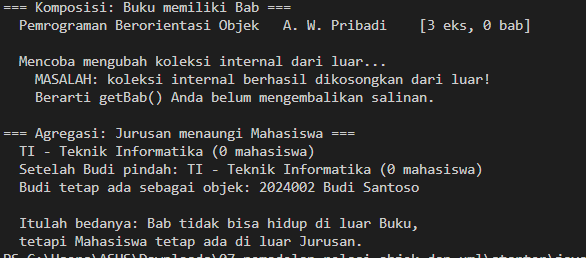
 
*Sebelum dilengkapi, `Buku` punya 0 bab, isi `getBab()` berhasil dihapus dari luar (muncul tulisan "MASALAH"), dan `Jurusan` selalu berisi 0 mahasiswa.*
 
**Output Program:**
 
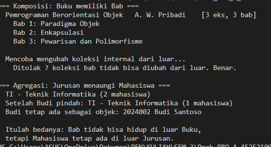
 
*Setelah dilengkapi, `Buku` punya 3 bab dan percobaan menghapus isi `getBab()` ditolak. Jumlah mahasiswa di `Jurusan` turun dari 2 menjadi 1 setelah Budi dikeluarkan, dan objek Budi tetap ada.*
 

---

## 2. Implementasi PHP

### 2.1. File: `relasi.php`
**Penjelasan Kode:**
enum `JenisKeangotaan` dan `StatusKoleksi`, serta kelas `Bab`, `Buku`, `Mahasiswa`, dan `Jurusan`. `Buku` memakai **komposisi** karena `Bab` dibuat di dalam `tambahBab()`. PHP tidak punya nested class seperti Java, jadi `Bab` tidak bisa dibuat `private`, dan aturannya dijaga lewat kebiasaan menulis kode. Method `getBab()` mengembalikan salinan array, karena array di PHP disalin saat dikembalikan. `Jurusan` memakai **agregasi** karena `Mahasiswa` datang dari luar lewat `daftarkan()`, dan NIM yang sama ditolak.

**Bukti Eksekusi (Screenshot):**
* **Before** *(Kondisi awal)*:

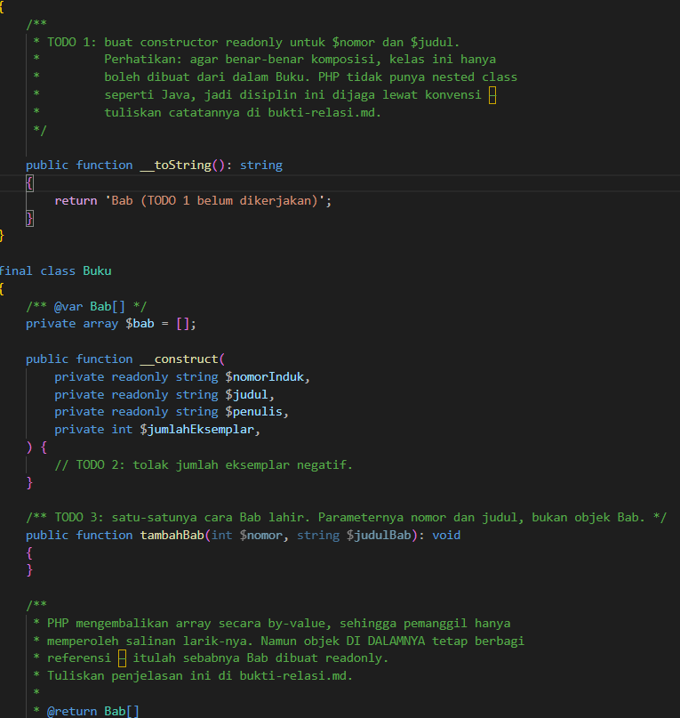

*Kondisi awal: `Bab` masih berisi teks "TODO 1 belum dikerjakan", dan beberapa method masih kosong.*

* **After** *(Kondisi akhir)*:

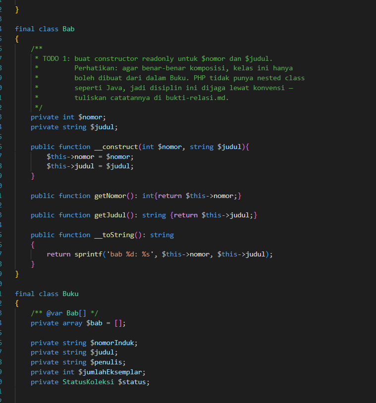

*Semua TODO sudah diisi.*

### 2.2. File: `main.php`
**Penjelasan Kode:**
> Tidak ada perubahan kode pada file ini. Alurnya sama dengan `Main.java`: membuat `Buku` dengan tiga bab, lalu membuat dua `Mahasiswa`, memasukkannya ke `Jurusan`, dan mengeluarkan Budi.

**Bukti Eksekusi (Screenshot):**
* Tidak ada perubahan kode pada file ini.

---

### Output
**output sebelum kode dilengkapi:**
 
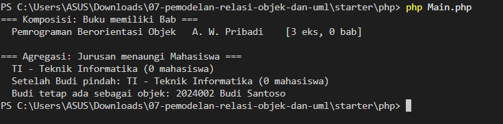

**Output Program:**
 
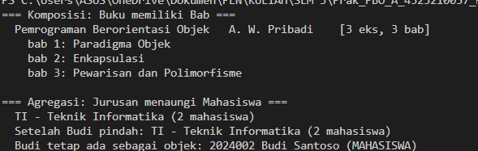
 
*Setelah dilengkapi, `Buku` punya 3 bab dan `Jurusan` berisi 2 mahasiswa. Objek Budi tetap ada setelah dikeluarkan. Namun jumlah mahasiswa setelah Budi pindah masih 2, belum turun menjadi 1 seperti di Java.*
 

 
*Sebelum dilengkapi, `Buku` punya 0 bab dan `Jurusan` selalu berisi 0 mahasiswa.*
## 3. Perbedaan Komposisi dan Agregasi

| Hal | Komposisi (`Buku` dan `Bab`) | Agregasi (`Jurusan` dan `Mahasiswa`) |
| :--- | :--- | :--- |
| Objek bagian dibuat | Di dalam induk | Di luar, lalu dimasukkan |
| Constructor bagian | `private` (Java) | `public` |
| Kalau induk hilang | Bagian ikut hilang | Bagian tetap ada |
| Getter koleksi | Salinan | Salinan |

---

## 4. Kesimpulan
> **Komposisi** artinya bagian dibuat dan dimiliki penuh oleh induknya. Contohnya `Bab` di dalam `Buku`. **Agregasi** artinya bagian dibuat di luar dan hanya "dipinjam" oleh induknya. Contohnya `Mahasiswa` di dalam `Jurusan`.
> Java bisa menjaga aturan komposisi dengan nested class dan constructor `private`. PHP tidak punya nested class, jadi aturannya dijaga lewat kebiasaan menulis kode.
