# LAPORAN PRAKTIKUM PEMROGRAMAN BERBASIS OBJEK

| Informasi Praktikan | Keterangan |
| :--- | :--- |
| **Nama** | *Prevansyah Sjafar* |
| **NPM** | *4525210057* |
| **Kelas** | A |
| **Mata Kuliah** | Pemrograman Berbasis Objek (PBO) |
| **Pertemuan** | 09 — Package, Namespace, dan Build Tool |
| **Tanggal** | *Kamis, 29 Oktober 2026* |
| **Dosen Pengampu** | *Adi Wahyu Pribadi, S.Si., M.Kom* |

---

## 1. Implementasi Java

Program Java menggunakan package `id.ac.univpancasila.perpustakaan` dan dibangun dengan Maven. Aplikasi mensimulasikan sistem perpustakaan: pengelolaan koleksi buku dan anggota, transaksi peminjaman/pengembalian, serta perhitungan denda.

### 1.1. `model/Buku.java`

**Penjelasan kode:**

Kelas `Buku` menyimpan nomor induk, judul, penulis, jumlah eksemplar, dan daftar `Bab`. Bab ditambahkan melalui `tambahBab()`, sehingga menggambarkan relasi komposisi. Kelas juga menyediakan pengecekan ketersediaan dan operasi untuk mengurangi atau menambah stok. Jumlah eksemplar tidak boleh negatif.

**Screenshot kode:**

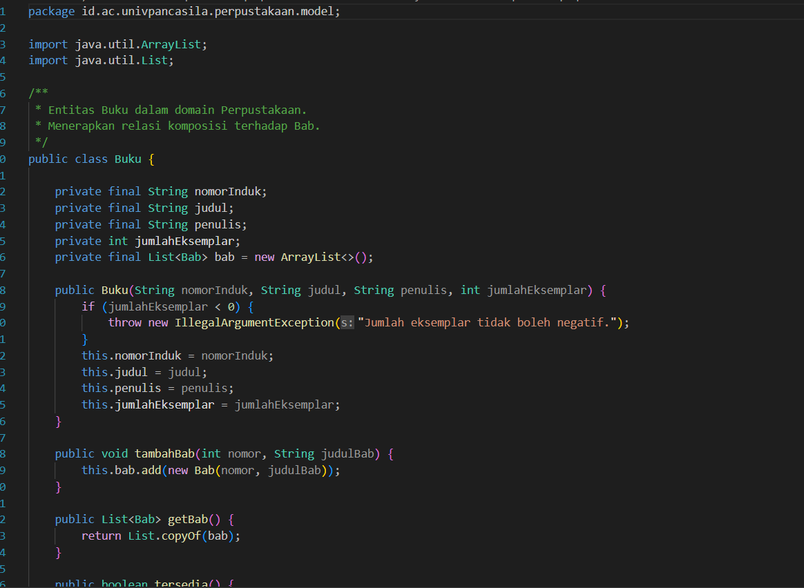

### 1.2. `model/Anggota.java`

**Penjelasan kode:**

Kelas `Anggota` merepresentasikan anggota perpustakaan dengan nomor anggota, nama, dan jenis keanggotaan. Data identitas disimpan sebagai atribut tetap dan divalidasi agar nomor anggota serta nama tidak kosong. Kelas menyediakan getter dan representasi teks anggota.

**Screenshot kode:**

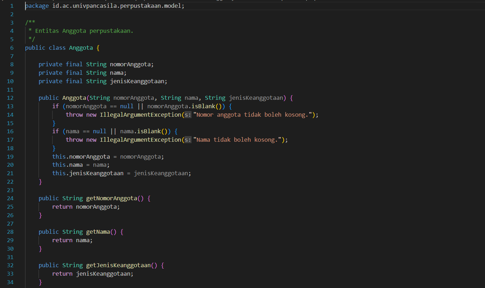

### 1.3. `model/Peminjaman.java`

**Penjelasan kode:**

Kelas `Peminjaman` menyimpan ID transaksi, anggota, buku, tanggal pinjam, tanggal jatuh tempo, dan tanggal kembali. Tanggal jatuh tempo dihitung menggunakan `LocalDate` dengan menambahkan lama hari peminjaman ke tanggal pinjam. Status pengembalian diketahui dari ada atau tidaknya tanggal kembali.

**Screenshot kode:**

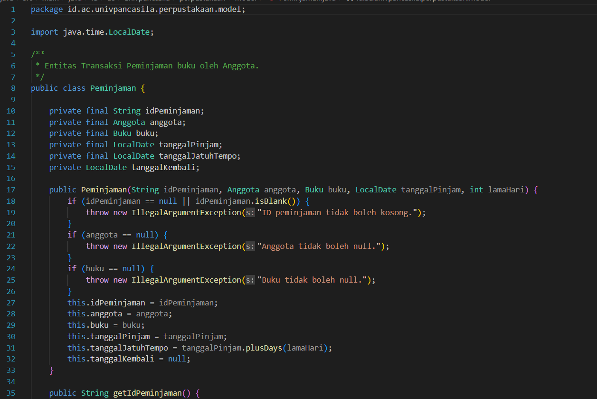

### 1.4. `service/PerpustakaanService.java`

**Penjelasan kode:**

Kelas layanan mengelola daftar koleksi, anggota, dan peminjaman. Fitur yang disediakan antara lain menambahkan dan mencari buku, mendaftarkan dan mencari anggota, memproses peminjaman, memproses pengembalian, serta menghitung denda. Peminjaman memeriksa anggota, buku, stok, dan batas maksimal tiga peminjaman aktif per anggota. Tarif denda per hari adalah Rp1.000 untuk mahasiswa, Rp500 untuk dosen, dan Rp0 untuk anggota lainnya.

**Screenshot kode:**

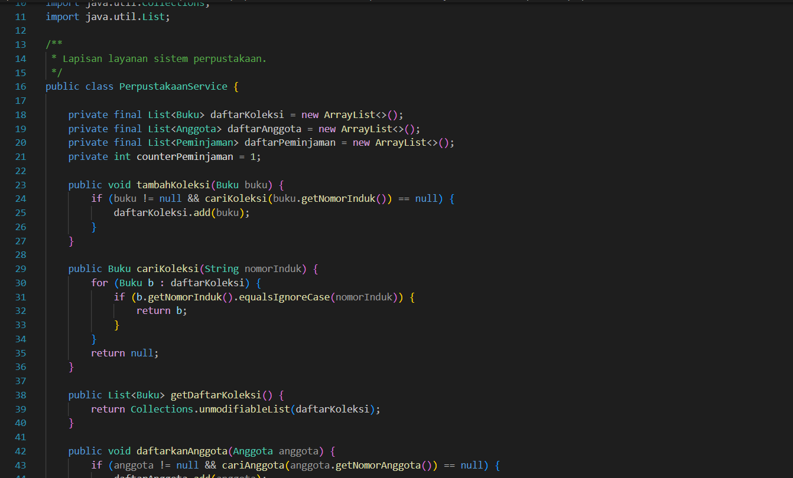

### 1.5. `util/Format.java`

**Penjelasan kode:**

Kelas utilitas `Format` menyediakan fungsi untuk menampilkan nominal dalam format mata uang Rupiah dan tanggal dalam format Indonesia. Kelas ini tidak perlu dibuat menjadi objek karena method-nya bersifat `static`.

**Screenshot kode:**

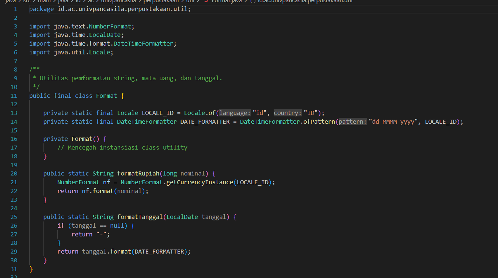

### 1.6. `App.java`

**Penjelasan kode:**

`App.java` merupakan titik masuk program. Aplikasi membuat beberapa buku beserta babnya, mendaftarkan anggota, melakukan simulasi peminjaman dan pengembalian, kemudian menampilkan koleksi buku, transaksi peminjaman, dan rincian denda.

**Screenshot kode:**

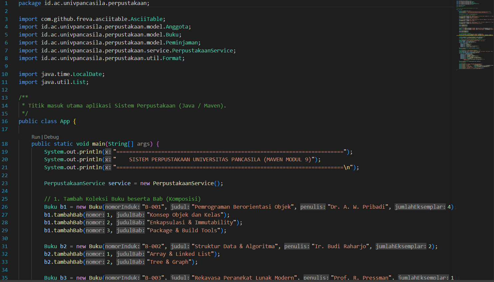

### Output Java

Output memperlihatkan daftar koleksi buku, daftar transaksi peminjaman, status pengembalian, dan simulasi denda keterlambatan.

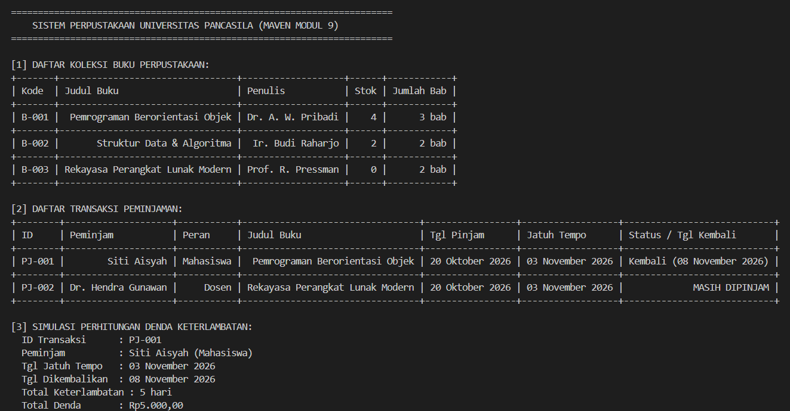

---

## 2. Implementasi PHP

Program PHP menggunakan namespace `Perpustakaan\Model`, `Perpustakaan\Service`, dan `Perpustakaan\Util`. Autoload kelas dikelola oleh Composer melalui `vendor/autoload.php`, sehingga tidak perlu melakukan `require_once` satu per satu untuk setiap kelas.

### 2.1. `src/Model/Buku.php`

**Penjelasan kode:**

Kelas `Buku` menyimpan data buku dan daftar bab. Bab ditambahkan melalui method `tambahBab()`. Kelas juga memiliki operasi untuk mengecek ketersediaan stok, mengurangi stok saat buku dipinjam, dan menambah stok saat buku dikembalikan.

**Screenshot kode:**

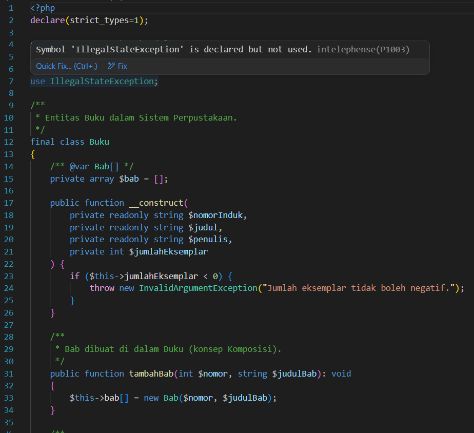

### 2.2. `src/Model/Bab.php`

**Penjelasan kode:**

Kelas `Bab` merepresentasikan bab pada buku dengan nomor dan judul. Bab dibuat dan ditambahkan melalui kelas `Buku` sebagai bentuk komposisi dalam implementasi aplikasi.

**Screenshot kode:**

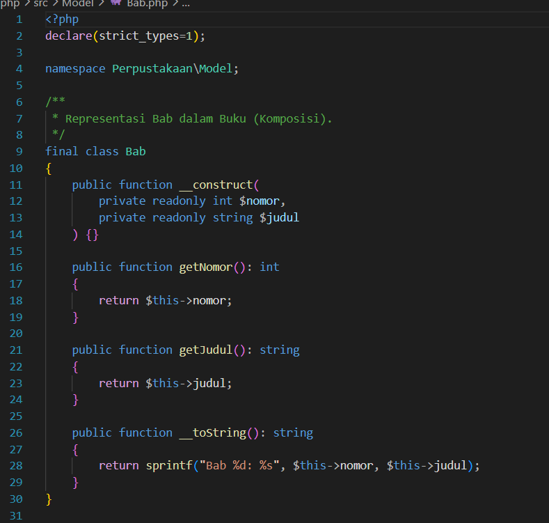

### 2.3. `src/Model/Anggota.php`

**Penjelasan kode:**

Kelas `Anggota` menyimpan nomor anggota, nama, dan jenis keanggotaan. Atribut menggunakan property `readonly` agar identitas tidak diubah setelah objek dibuat. Constructor memvalidasi nomor anggota dan nama agar tidak kosong.

**Screenshot kode:**

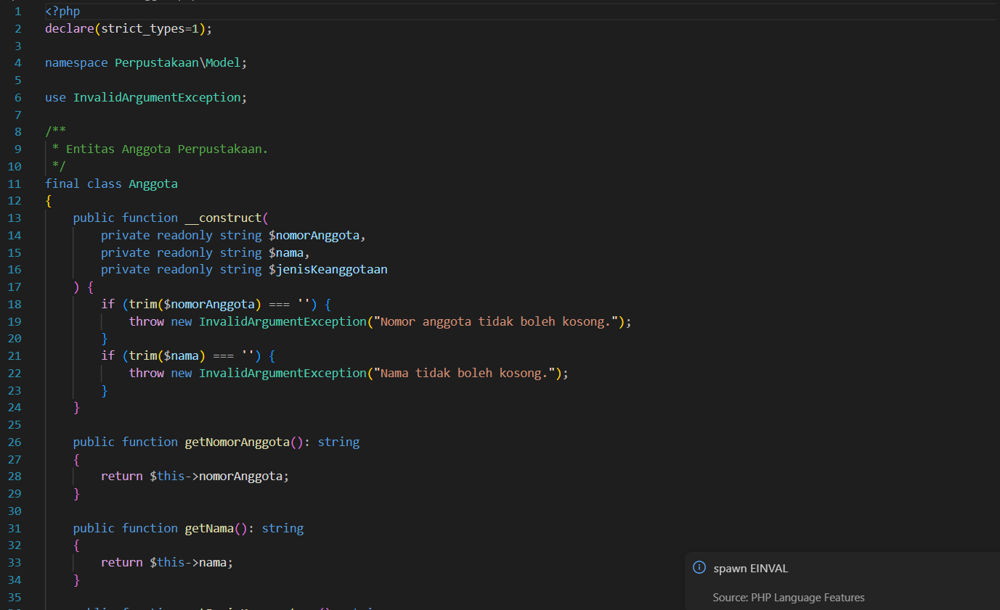

### 2.4. `src/Model/Peminjaman.php`

**Penjelasan kode:**

Kelas `Peminjaman` menyimpan data transaksi dan menggunakan library Carbon untuk menghitung tanggal jatuh tempo. Tanggal kembali bersifat nullable dan digunakan untuk mengetahui apakah transaksi sudah dikembalikan.

**Screenshot kode:**

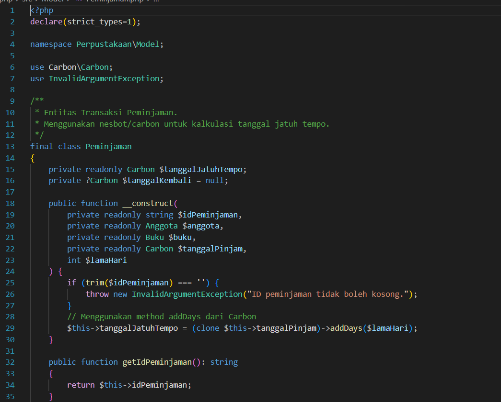

### 2.5. `src/Service/PerpustakaanService.php`

**Penjelasan kode:**

Kelas layanan mengelola koleksi buku, anggota, dan transaksi. Proses peminjaman memeriksa keberadaan anggota dan buku, stok buku, serta batas tiga peminjaman aktif. Pengembalian memperbarui tanggal kembali dan stok buku. Denda dihitung berdasarkan keterlambatan dan jenis keanggotaan.

**Screenshot kode:**

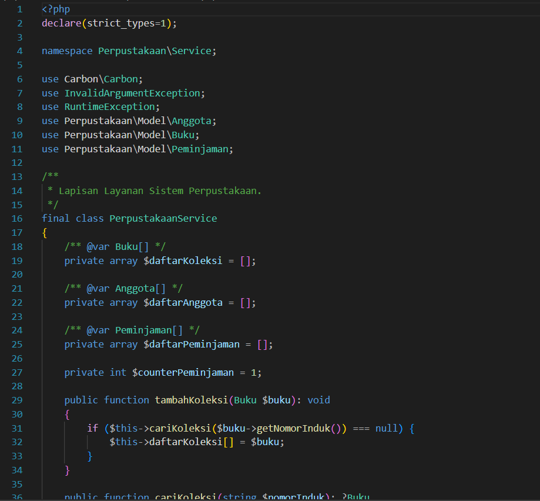

### 2.6. `src/Util/Format.php`

**Penjelasan kode:**

Kelas `Format` menyediakan method untuk memformat nominal ke Rupiah dan tanggal ke format Indonesia dengan bantuan Carbon.

**Screenshot kode:**

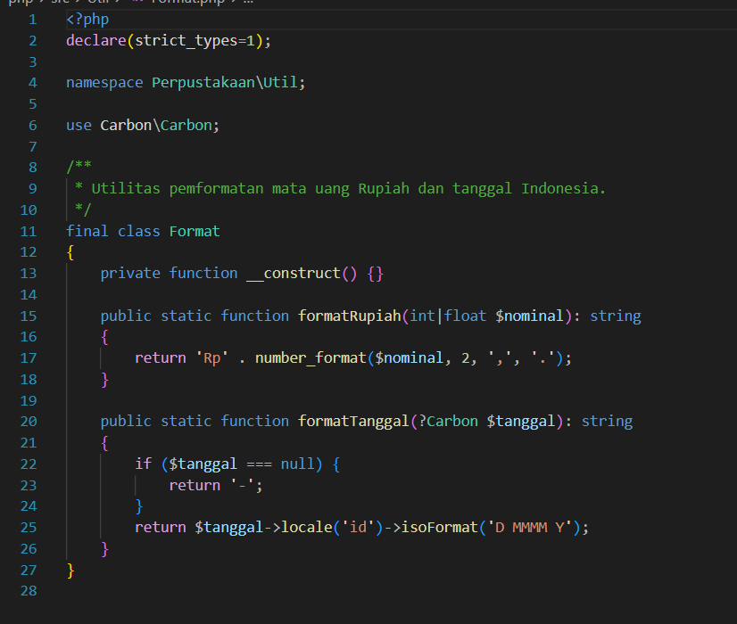

### 2.7. `main.php`

**Penjelasan kode:**

`main.php` adalah titik masuk aplikasi PHP. File ini memanggil autoload Composer, membuat objek buku dan anggota, melakukan simulasi peminjaman serta pengembalian, lalu menampilkan daftar buku, transaksi, dan perhitungan denda.

**Screenshot kode:**

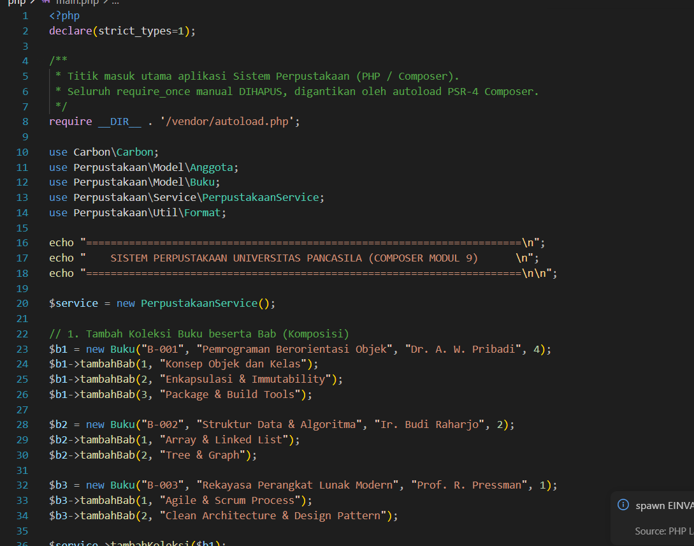

### Output PHP

Output memperlihatkan koleksi buku, transaksi peminjaman, status pengembalian, dan rincian perhitungan denda keterlambatan.

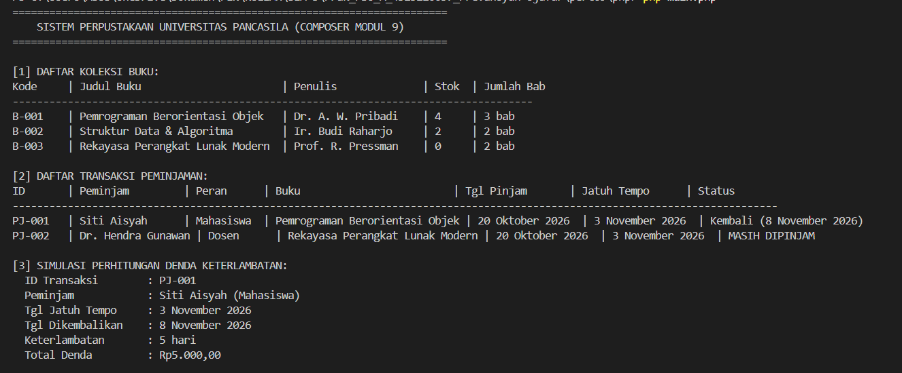

---

## 3. Package, Namespace, dan Build Tool

| Teknologi | Implementasi |
| :--- | :--- |
| **Package Java** | `id.ac.univpancasila.perpustakaan` beserta subpackage `model`, `service`, dan `util` |
| **Build tool Java** | Maven, dengan konfigurasi pada `java/pom.xml` |
| **Namespace PHP** | `Perpustakaan\Model`, `Perpustakaan\Service`, dan `Perpustakaan\Util` |
| **Dependency manager PHP** | Composer, dengan konfigurasi pada `php/composer.json` |
| **Autoload PHP** | PSR-4 melalui `vendor/autoload.php` |
| **Library tanggal PHP** | Carbon untuk perhitungan tanggal dan tanggal jatuh tempo |

---

## 4. Kesimpulan

Praktikum ini menerapkan pemisahan kelas berdasarkan tanggung jawab ke dalam model, service, dan utilitas. Java mengorganisasi kelas menggunakan package serta Maven sebagai build tool, sedangkan PHP menggunakan namespace dan Composer untuk pengelolaan dependency serta autoload PSR-4. Aplikasi perpustakaan dapat menjalankan simulasi pengelolaan buku, anggota, peminjaman, pengembalian, dan denda keterlambatan.
