# LAPORAN PRAKTIKUM PEMROGRAMAN BERBASIS OBJEK

| Informasi Praktikan | Keterangan |
| :--- | :--- |
| **Nama** | *Prevansyah Sjafar* |
| **NPM** | *4525210057* |
| **Kelas** | A |
| **Mata Kuliah** | Pemrograman Berbasis Objek (PBO) |
| **Pertemuan** | 10 — Exception Handling dan Pemrograman Defensif |
| **Tanggal** | *Kamis, 28 Oktober 2026* |
| **Dosen Pengampu** | *Adi Wahyu Pribadi, S.Si., M.Kom* |

---

## 1. Implementasi Java

Program Java menggunakan package `id.ac.univpancasila.perpustakaan` dan dibangun dengan Maven. Aplikasi berupa menu di terminal untuk menambah buku, menambah anggota, dan meminjam buku. Kegagalan peminjaman tidak lagi dijawab dengan `false`, tetapi dengan exception khusus yang menjelaskan penyebabnya.

### 1.1. `exception/PerpustakaanException.java`

**Penjelasan kode:**

Ini adalah induk dari semua exception di aplikasi perpustakaan. Kelas ini turunan `RuntimeException` (unchecked), jadi pemanggil tidak dipaksa menulis `try-catch`. Karena punya induk yang sama, semua kegagalan perpustakaan bisa ditangkap sekaligus dengan satu `catch`.

**Screenshot kode:**

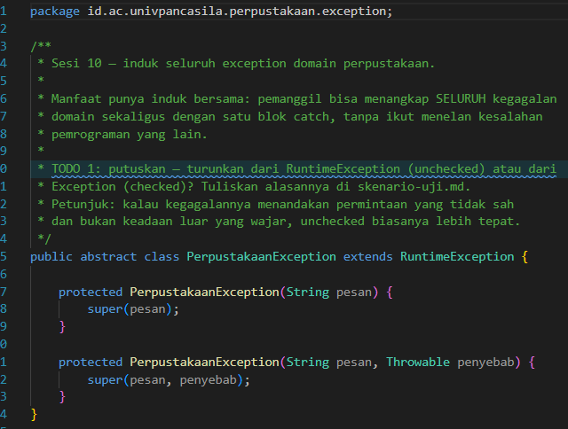

### 1.2. `exception/BukuTidakDitemukanException.java`

**Penjelasan kode:**

Exception ini dilempar saat ISBN tidak ada di katalog. Selain pesan, exception menyimpan `isbn` sehingga data penyebabnya bisa diambil lewat `getIsbn()`, tanpa harus membaca isi kalimat pesan.

**Screenshot kode:**

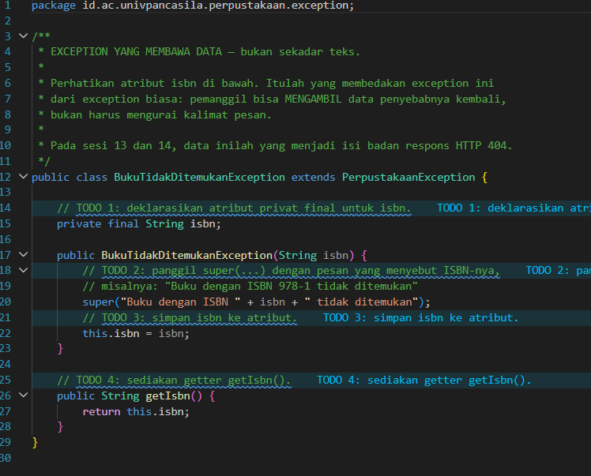

### 1.3. `exception/AnggotaTidakDitemukanException.java`

**Penjelasan kode:**

Dilempar saat ID anggota belum terdaftar. Polanya sama dengan exception buku, tetapi data yang dibawa adalah `idAnggota` dengan getter `getIdAnggota()`.

**Screenshot kode:**

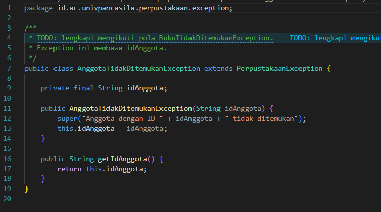

### 1.4. `exception/BukuSedangDipinjamException.java`

**Penjelasan kode:**

Dilempar saat stok buku habis. Exception membawa dua data, yaitu `isbn` (untuk diolah sistem) dan `judul` (agar pesan lebih mudah dipahami pengguna).

**Screenshot kode:**

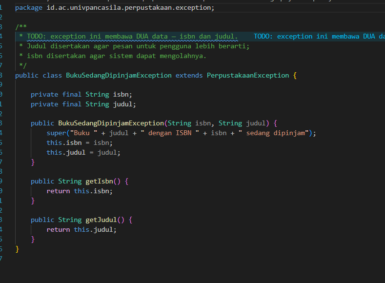

### 1.5. `exception/BatasPinjamTerlampauiException.java`

**Penjelasan kode:**

Dilempar saat anggota sudah meminjam sebanyak batas maksimum. Exception membawa `idAnggota` dan `batas`, sehingga pemanggil bisa menampilkan batasnya tanpa perlu tahu aturannya sendiri.

**Screenshot kode:**

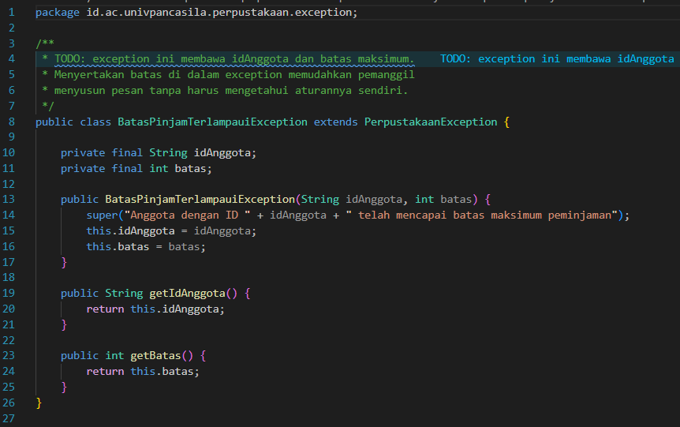

### 1.6. `service/LibraryServiceKotor.java`

**Penjelasan kode:**

Ini versi awal sebagai bahan refactoring. Method `pinjam()` memakai `if` bersarang empat tingkat sehingga sulit dibaca. Saat gagal, method hanya mengembalikan `false` tanpa alasan, jadi pemanggil tidak tahu apa penyebabnya.

**Screenshot kode:**

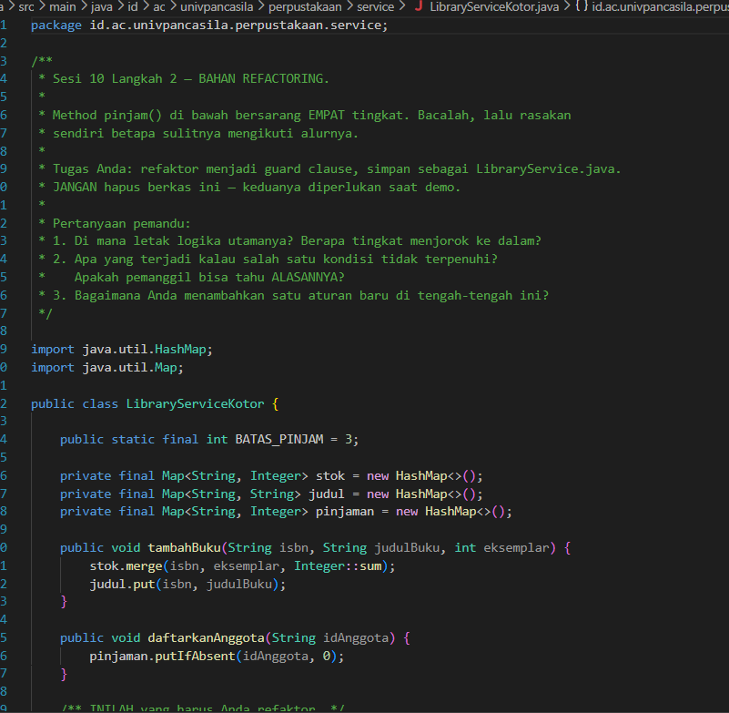

### 1.7. `service/LibraryService.java`

**Penjelasan kode:**

Ini hasil refactoring memakai *guard clause*. Setiap syarat dicek satu per satu dari atas: anggota ada, buku ada, stok tersedia, dan batas pinjam belum penuh. Kalau ada yang tidak terpenuhi, langsung dilempar exception yang sesuai. Kalau semua lolos, stok dikurangi dan jumlah pinjaman anggota bertambah. Alurnya lurus dan mudah ditambah aturan baru.

**Screenshot kode:**

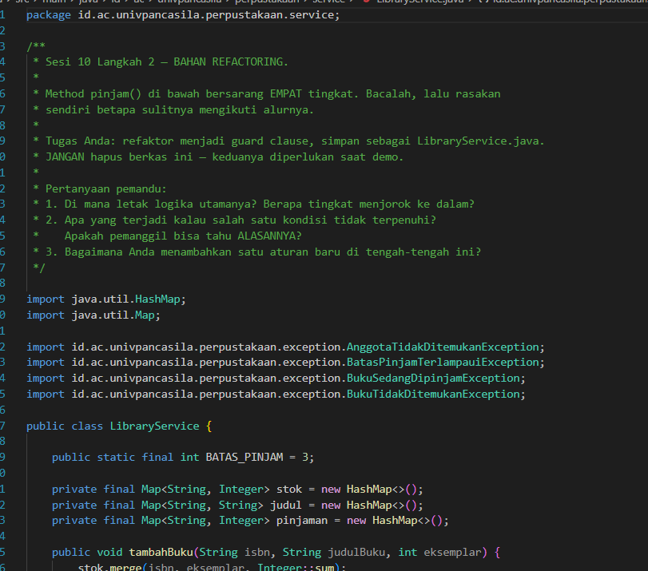

### 1.8. `service/PerpustakaanService.java`

**Penjelasan kode:**

Kelas ini mengurus interaksi dengan pengguna: form tambah anggota, tambah buku, dan pinjam buku. Input dicek lebih dulu, misalnya ID atau ISBN tidak boleh kosong dan jumlah eksemplar harus angka lebih dari 0. Pada peminjaman, `catch (PerpustakaanException)` menampilkan pesan error domain beserta datanya, sedangkan `catch (Exception)` menangani kesalahan lain.

**Screenshot kode:**

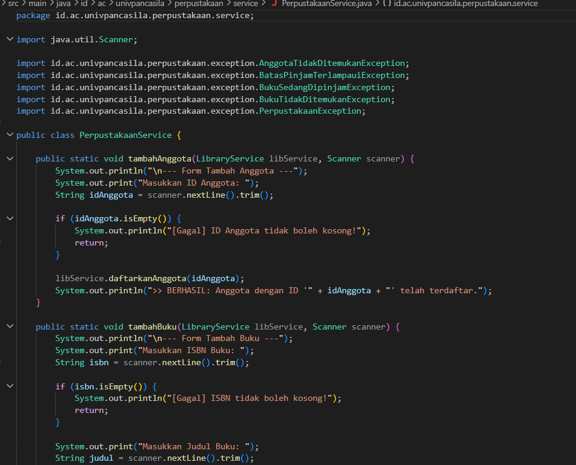

### 1.9. `Main.java`

**Penjelasan kode:**

Titik masuk program. Menampilkan menu berulang (1 Tambah Buku, 2 Tambah Anggota, 3 Pinjam Buku, 0 Keluar) dan memanggil method yang sesuai. Saat keluar, program menulis daftar buku ke `laporan_buku.txt` memakai `try-with-resources` agar file otomatis tertutup, dan `IOException` ditangani bila penulisan gagal.

**Screenshot kode:**

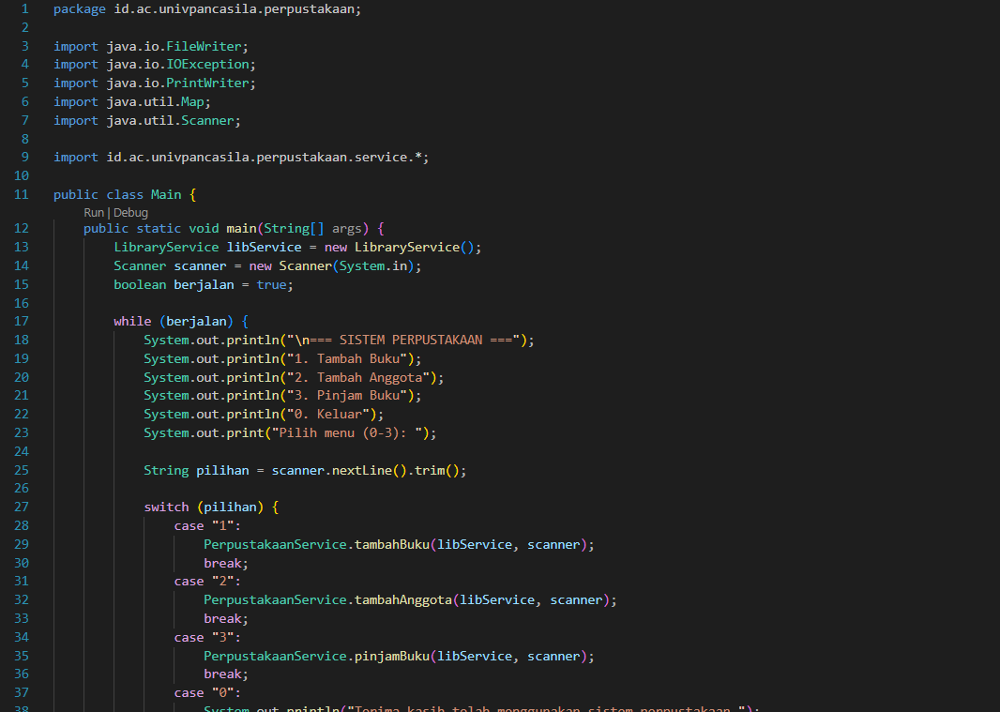

### Output Java

Output memperlihatkan menu utama, lalu form tambah buku dengan ISBN `1312`, judul `rapen`, dan 5 eksemplar. Program menampilkan pesan berhasil dan kembali ke menu.

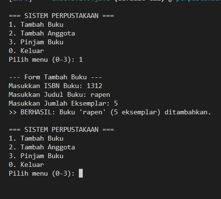

---

## 2. Implementasi PHP

Program PHP menggunakan namespace `Perpustakaan\Exception` dan `Perpustakaan\Service`. Autoload kelas dikelola Composer (PSR-4) melalui `vendor/autoload.php`. Logikanya sama dengan versi Java, yaitu peminjaman yang gagal melempar exception khusus.

### 2.1. `src/Exception/PerpustakaanException.php`

**Penjelasan kode:**

Induk semua exception perpustakaan, turunan `RuntimeException`. PHP tidak punya checked exception, jadi semua exception bersifat unchecked. Karena itu keterangan `@throws` di komentar menjadi penting sebagai petunjuk bagi pembaca kode.

**Screenshot kode:**

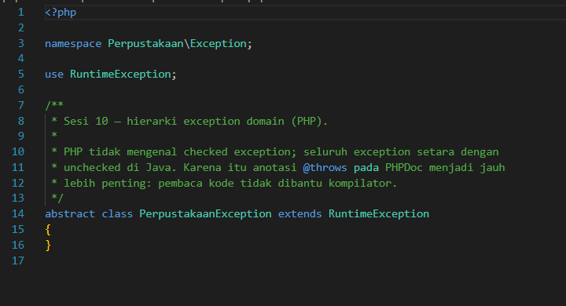

### 2.2. `src/Exception/BukuTidakDitemukanException.php`

**Penjelasan kode:**

Dilempar saat ISBN tidak ada di katalog. Memakai *constructor property promotion* dengan `readonly`, sehingga `$isbn` otomatis tersimpan dan tidak bisa diubah. Datanya diambil lewat `getIsbn()`.

**Screenshot kode:**

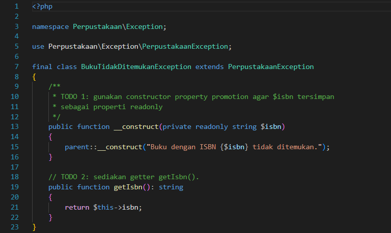

### 2.3. `src/Exception/AnggotaTidakDitemukanException.php`

**Penjelasan kode:**

Dilempar saat anggota belum terdaftar. Membawa `$idAnggota` yang bisa diambil lewat `getIdAnggota()`.

**Screenshot kode:**

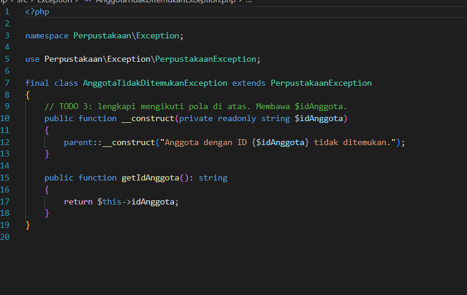

### 2.4. `src/Exception/BukuSedangDipinjamException.php`

**Penjelasan kode:**

Dilempar saat stok buku habis. Membawa `$isbn` dan `$judul`, dengan getter `getIsbn()` dan `getJudul()`.

**Screenshot kode:**

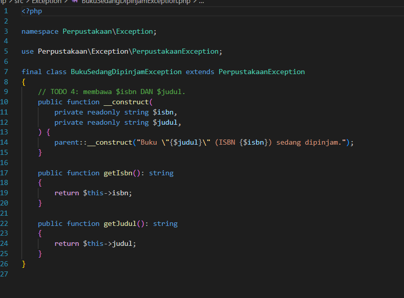

### 2.5. `src/Exception/BatasPinjamTerlampauiException.php`

**Penjelasan kode:**

Dilempar saat anggota sudah mencapai batas pinjam. Membawa `$idAnggota` dan `$batas`, dengan getter `getIdAnggota()` dan `getBatas()`.

**Screenshot kode:**

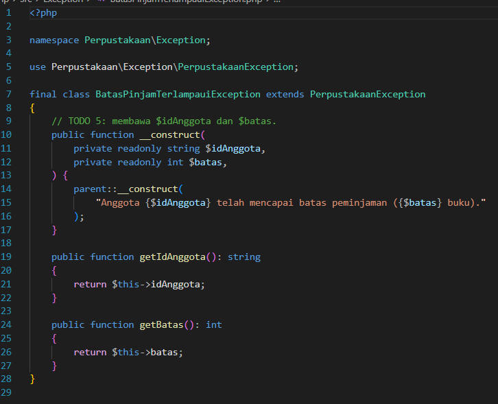

### 2.6. `src/Service/LibraryServiceKotor.php`

**Penjelasan kode:**

Versi awal bahan refactoring. Method `pinjam()` bersarang empat tingkat dan hanya mengembalikan `true` atau `false` tanpa menjelaskan penyebab gagal.

**Screenshot kode:**

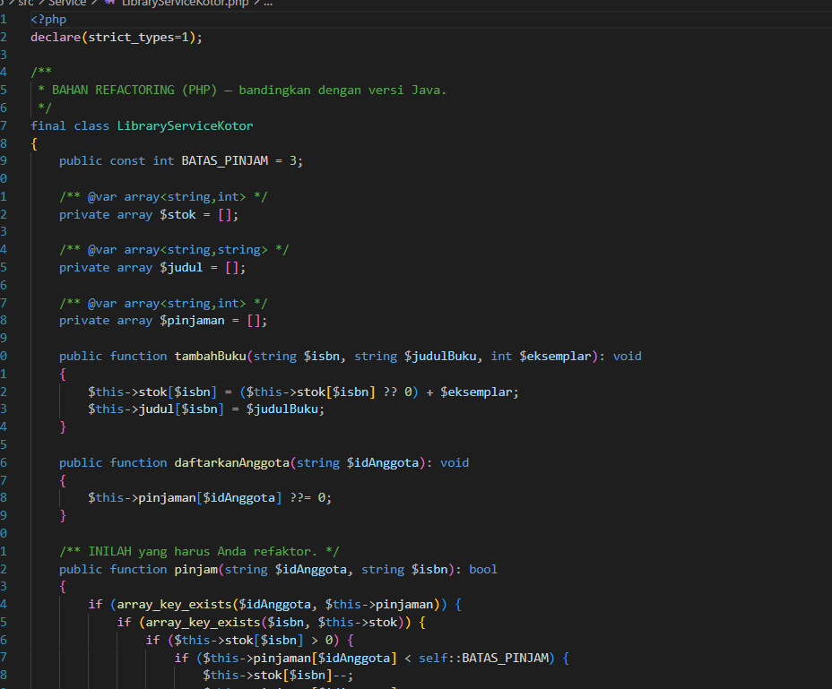

### 2.7. `src/Service/LibraryService.php`

**Penjelasan kode:**

Hasil refactoring dengan guard clause. Method `pinjam()` mengecek anggota, buku, stok, dan batas pinjam secara berurutan dan melempar exception yang sesuai bila gagal. Jika semua syarat terpenuhi, stok berkurang dan pinjaman anggota bertambah. Komentar `@throws` mendaftar semua exception yang mungkin dilempar.

**Screenshot kode:**

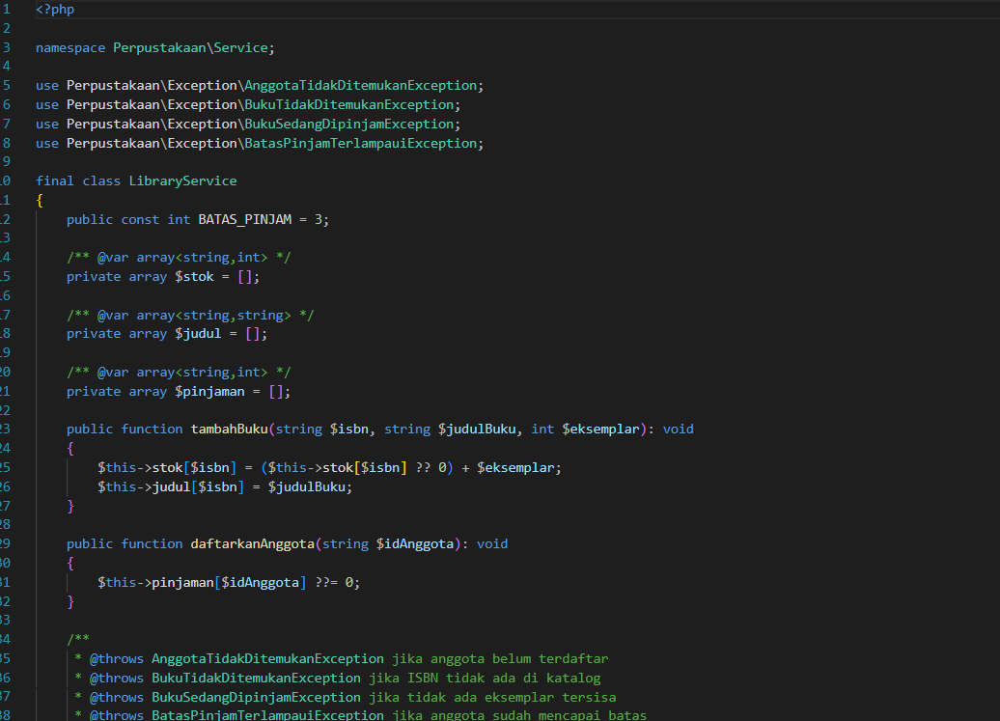

### 2.8. `Main.php`

**Penjelasan kode:**

Titik masuk program PHP, diletakkan di luar folder `src`. File ini membuat dua buku dan dua anggota, lalu menjalankan tujuh percobaan peminjaman. Setiap kegagalan ditangkap dengan `catch (PerpustakaanException)` dan pesannya ditampilkan. Setelah itu fungsi `createReport()` menulis `laporan_buku.txt`, dengan blok `finally` yang memastikan file selalu ditutup.

**Screenshot kode:**

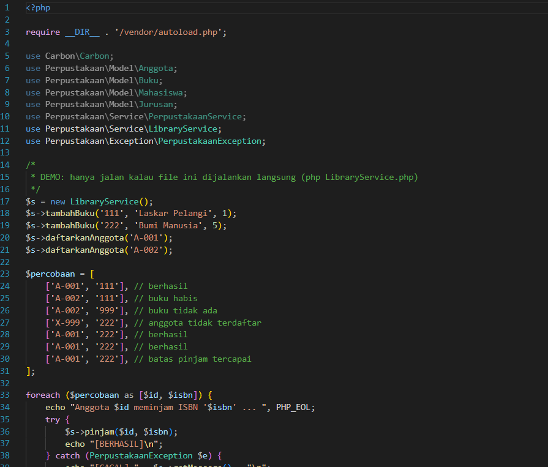

### Output PHP

Output memperlihatkan tujuh percobaan peminjaman: dua berhasil di awal, lalu gagal karena buku sedang dipinjam, ISBN tidak ditemukan, dan anggota tidak terdaftar. Dua percobaan berikutnya berhasil, dan yang terakhir gagal karena batas 3 buku tercapai. Di akhir, laporan berhasil disimpan dan file ditutup lewat blok `finally`.

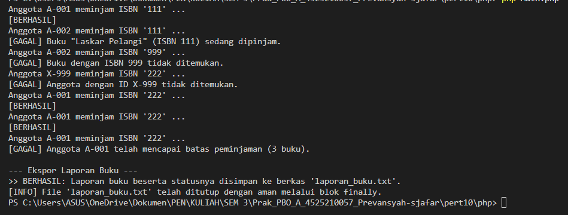

---

---

## 4. Kesimpulan

Praktikum ini mengganti kegagalan yang disampaikan lewat `return false` dengan `exception` khusus yang menjelaskan penyebabnya dan membawa datanya. Struktur `if` bersarang diubah menjadi guard clause sehingga alurnya lebih lurus dan mudah dikembangkan. 