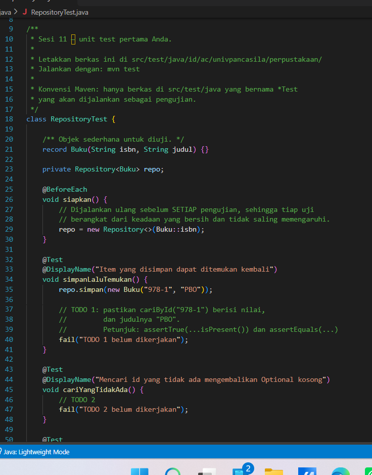
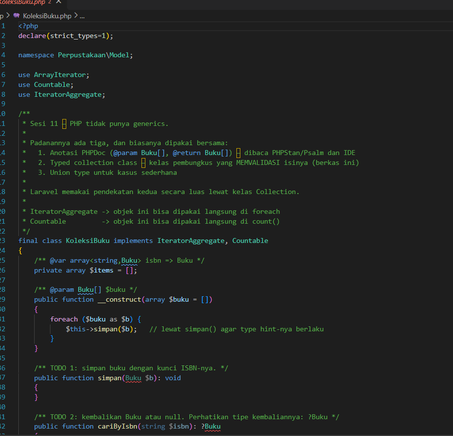
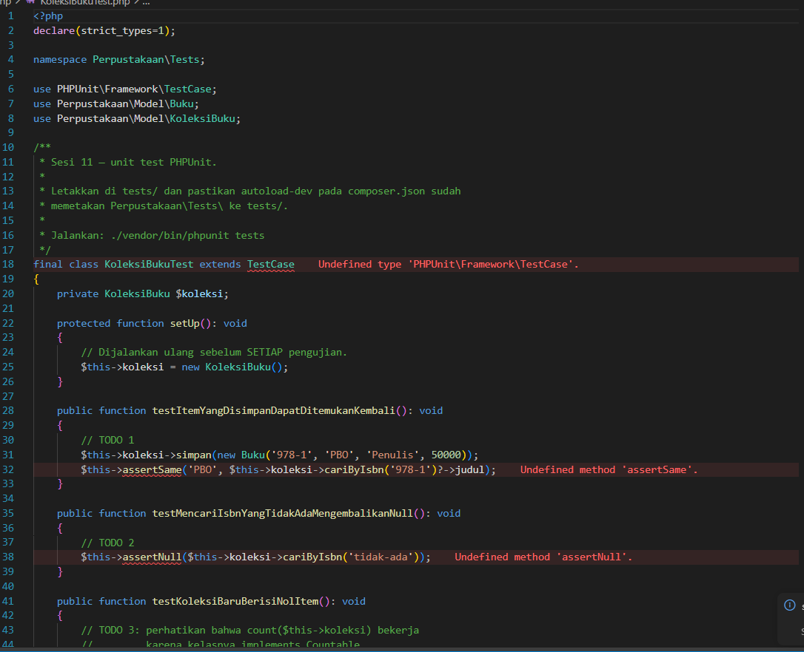

# LAPORAN PRAKTIKUM PEMROGRAMAN BERBASIS OBJEK

| Informasi Praktikan | Keterangan |
| :--- | :--- |
| **Nama** | *Prevansyah Sjafar* |
| **NPM** | *4525210057* |
| **Kelas** | A |
| **Mata Kuliah** | Pemrograman Berbasis Objek (PBO) |
| **Pertemuan** | 11 — Generics, Collections, Functional Style, dan Unit Testing |
| **Tanggal** | *Kamis 12 November 2026* |
| **Dosen Pengampu** | *Adi Wahyu Pribadi, S.Si., M.Kom* |

---

## 1. Implementasi Java

Program Java menggunakan package `id.ac.univpancasila.perpustakaan` dan dibangun dengan Maven. Pada pertemuan ini dibuat kelas generik `Repository<T>` yang menyimpan data dalam `Map`, lalu diuji dengan JUnit 5. Bagian ini memuat berkas yang kodenya berubah dari kerangka awal (*sebelum*) menjadi hasil pengerjaan (*sesudah*).

### 1.1. `Repository.java`

**Penjelasan kode:**

Kelas generik `Repository<T>` dengan *type parameter* `T`, sehingga bisa dipakai untuk tipe apa pun, tetapi setelah dipakai sebagai `Repository<Buku>` kompilator memastikan hanya `Buku` yang masuk dan keluar. Data disimpan di `LinkedHashMap` agar urutan penyimpanan terjaga. Kunci tiap item diambil lewat `Function<T, String> pengambilKunci`, jadi `Repository` tidak perlu tahu isi `T`. Empat method yang dikerjakan:

- `simpan()` menyimpan item dengan kunci dari `pengambilKunci` (kunci sama menimpa item lama).
- `cariById()` mengembalikan `Optional`, bukan `null`.
- `cariSemua()` mengembalikan salinan tak-berubah lewat `List.copyOf()` agar koleksi internal tidak bocor.
- `hapus()` mengembalikan `true` bila ada item yang terhapus.

**Screenshot sebelum:**

Method `simpan()`, `cariById()`, `cariSemua()`, dan `hapus()` masih kosong (hanya berisi komentar TODO 1–4).

**Screenshot sesudah:**

Keempat method sudah terisi implementasinya.

### 1.2. `RepositoryTest.java`

**Penjelasan kode:**

Unit test pertama untuk `Repository`. `@BeforeEach` membuat `Repository` baru sebelum setiap uji sehingga antar-uji tidak saling memengaruhi. Uji yang ada:

- item yang disimpan dapat ditemukan kembali,
- id yang tidak ada mengembalikan `Optional` kosong,
- item yang dihapus tidak ditemukan lagi,
- repository baru berisi nol item,
- `cariSemua()` tidak bisa diubah dari luar (`UnsupportedOperationException`),
- kunci sama menimpa item lama,
- menghapus id yang tidak ada mengembalikan `false`,
- urutan penyimpanan terjaga.

**Screenshot sebelum:**

Method uji `TODO 1–5` masih kosong, belum ada `assert`.

**Screenshot sesudah:**

Semua uji sudah berisi `assertTrue`, `assertEquals`, `assertFalse`, dan `assertThrows`, ditambah tiga uji tambahan.

---

## 2. Implementasi PHP

Program PHP memakai namespace `Perpustakaan\Model` (kelas) dan `Perpustakaan\Tests` (pengujian). PHP tidak punya generics, jadi padanannya dibuat dengan *typed collection class* `KoleksiBuku`. Pengujian memakai PHPUnit. Bagian ini memuat berkas yang kodenya berubah dari kerangka awal (*sebelum*) menjadi hasil pengerjaan (*sesudah*).

### 2.1. `KoleksiBuku.php`

**Penjelasan kode:**

Typed collection class sebagai padanan generics. Kelas ini `implements IteratorAggregate` (bisa dipakai di `foreach`) dan `Countable` (bisa dipakai di `count()`). Item disimpan di array dengan kunci ISBN. Method yang dikerjakan:

- `simpan()` menyimpan buku dengan kunci ISBN.
- `cariByIsbn()` mengembalikan `?Buku` (buku atau `null`).
- `filter()` memakai `array_filter` lalu `array_values` agar indeks tidak berlubang.
- `map()` memakai `array_map`. Urutan argumennya berbeda dari `array_filter` (callable dulu).
- `jumlahkan()` memakai `array_reduce`.
- `kelompokkan()` mengelompokkan item berdasarkan kunci hasil fungsi.

**Screenshot sebelum:**

Method `simpan()`, `cariByIsbn()`, `filter()`, `map()`, `jumlahkan()`, dan `kelompokkan()` masih kosong (TODO 1–6).

**Screenshot sesudah:**

Semua method sudah terisi implementasinya.

### 2.2. `KoleksiBukuTest.php`

**Penjelasan kode:**

Unit test PHPUnit untuk `KoleksiBuku`. `setUp()` membuat koleksi baru sebelum setiap uji. Uji yang ada: item dapat ditemukan kembali, ISBN tak ada mengembalikan `null`, koleksi baru berisi nol item, `filter`, `jumlahkan`, `semua()` berindeks urut, ISBN sama menimpa item lama, `filter` tidak meninggalkan indeks berlubang, `kelompokkan` berdasarkan penulis, dan iterasi dengan `foreach`.

**Screenshot sebelum:**

Method uji `TODO 1–5` masih kosong, belum ada `assert`.

**Screenshot sesudah:**

Semua uji sudah berisi `assertSame`, `assertNull`, dan `assertCount`, ditambah uji tambahan.

---

