# LAPORAN PRAKTIKUM PEMROGRAMAN BERBASIS OBJEK

| Informasi Praktikan | Keterangan |
| :--- | :--- |
| **Nama** | *Prevansyah Sjafar* |
| **NPM** | *4525210057* |
| **Kelas** | A |
| **Mata Kuliah** | Pemrograman Berbasis Objek (PBO) |
| **Pertemuan** | 12 — REFACTORING |
| **Tanggal** | *Kamis 19 November 2026* |
| **Dosen Pengampu** | *Adi Wahyu Pribadi, S.Si., M.Kom* |

---

## 1. Implementasi Java

Program Java menggunakan package `id.ac.univpancasila.perpustakaan` dan dibangun dengan Maven. Pada pertemuan ini kode perpustakaan dirapikan (*refactoring*) tanpa mengubah fungsi utamanya. Ada dua pola desain yang dipakai:

- **Repository Pattern** — urusan "menyimpan dan mengambil buku" dipisah dari logika peminjaman.
- **Strategy Pattern + Factory** — aturan denda tidak lagi ditulis dengan rantai `if`, tetapi dipisah menjadi kelas-kelas kecil per jenis anggota.

Bagian ini memuat berkas yang kodenya berubah dari kerangka awal (*sebelum*) menjadi hasil pengerjaan (*sesudah*). Berkas yang tidak punya tangkapan layar *sebelum* berarti **program baru dibuat** pada pertemuan ini.

### 1.1. `AturanDenda.java`

**Penjelasan kode:**

`AturanDenda` adalah *interface* (daftar aturan main) untuk menghitung denda. Bayangkan seperti "formulir standar": siapa pun jenis anggotanya, perhitungan denda harus bisa menjawab dua pertanyaan:

- `hitung(int hariTerlambat)` — berapa denda untuk sekian hari terlambat? Hari negatif dianggap nol.
- `nama()` — apa nama aturan ini, untuk ditampilkan di laporan?

Dengan cara ini, kelas lain cukup tahu "ada aturan denda" tanpa peduli aturan yang mana. Inilah inti dari *Strategy Pattern*.

**Screenshot sebelum:**

Interface sudah ada, tetapi masih dipenuhi komentar penjelasan dan catatan TODO 1–3 (membuat tiga kelas denda, membuat factory, dan menambah `DendaAlumni`).

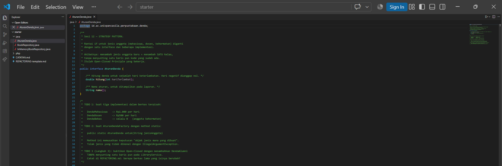

**Screenshot sesudah:**

Komentar TODO dihapus karena semua tugasnya sudah selesai. Tersisa interface yang bersih dengan dua method `hitung()` dan `nama()`.

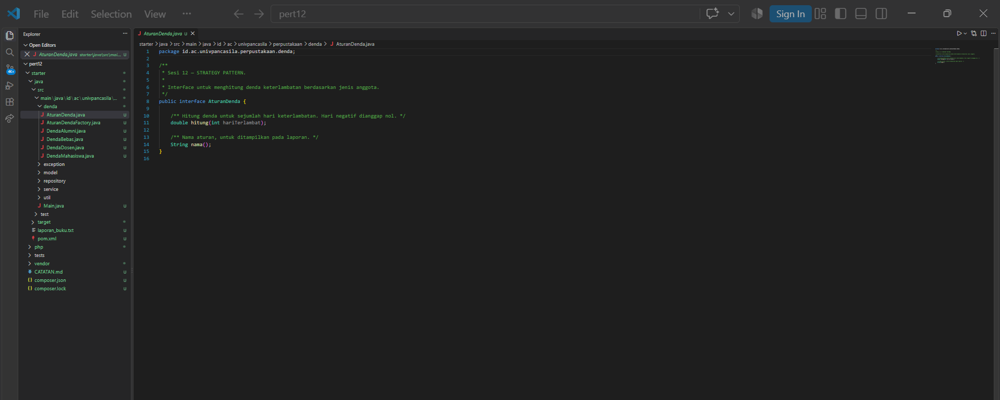

### 1.2. `AturanDendaFactory.java`

**Penjelasan kode:**

Program baru dibuat (tidak ada kondisi sebelumnya).

Factory ibarat "petugas pemilih": kita cukup menyebut jenis anggota (misalnya `"mahasiswa"`), lalu petugas ini yang memutuskan aturan denda mana yang dibuat. Dengan begitu, keputusan "jenis mana yang dipakai" terkumpul di satu tempat saja.

- Method `untuk(String jenisAnggota)` memakai `switch` untuk memilih: `mahasiswa` → `DendaMahasiswa`, `dosen` → `DendaDosen`, `kehormatan` / `bebas` → `DendaBebas`, `alumni` → `DendaAlumni`.
- Teks diubah ke huruf kecil dan dirapikan dengan `trim().toLowerCase()`, jadi `" Dosen "` tetap dikenali.
- Jenis `null` atau yang tidak dikenal ditolak dengan `IllegalArgumentException`.
- Konstruktor dibuat `private` karena kelas ini hanya berisi method statis dan tidak perlu dibuat objeknya.

**Screenshot sebelum:**

Program baru dibuat, jadi belum ada screenshot sebelum.

**Screenshot sesudah:**

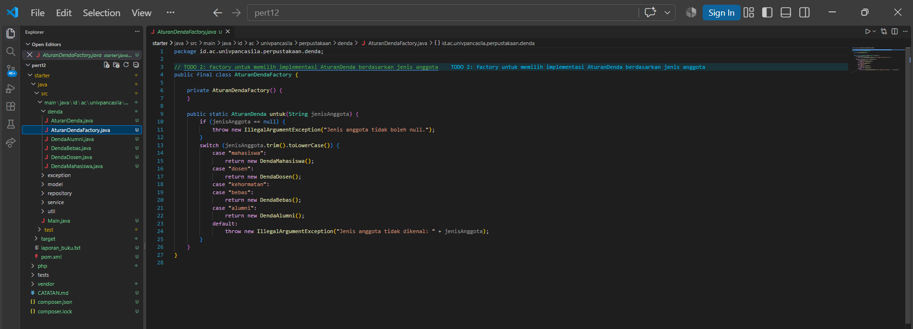

### 1.3. `DendaMahasiswa.java`

**Penjelasan kode:**

Program baru dibuat (tidak ada kondisi sebelumnya).

Kelas ini adalah satu "strategi" denda, yaitu untuk mahasiswa dengan tarif **Rp1.000 per hari**. Cara hitungnya sederhana: `hari terlambat × 1000`. Bagian `Math.max(0, hariTerlambat)` memastikan hari negatif (belum terlambat) tidak menghasilkan denda minus, tetapi tetap nol. Method `nama()` mengembalikan teks `Mahasiswa (Rp1.000/hari)` yang tampil di menu program.

**Screenshot sebelum:**

Program baru dibuat, jadi belum ada screenshot sebelum.

**Screenshot sesudah:**

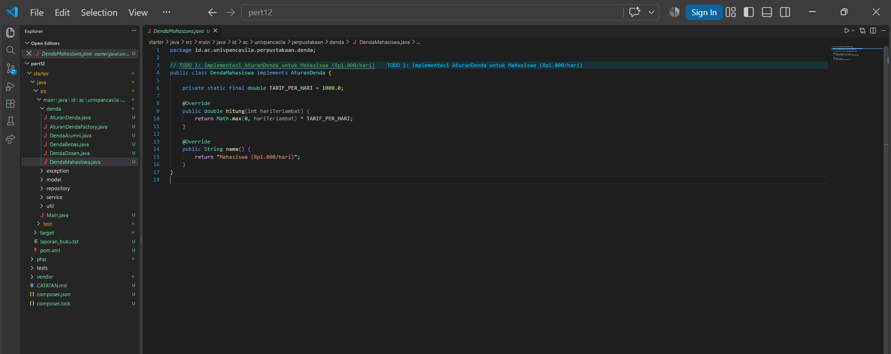

### 1.4. `DendaDosen.java`

**Penjelasan kode:**

Program baru dibuat (tidak ada kondisi sebelumnya).

Bentuknya sama persis dengan `DendaMahasiswa`, hanya tarifnya berbeda: **Rp500 per hari** untuk dosen. Karena sama-sama mengikuti interface `AturanDenda`, kelas lain bisa memakainya bergantian tanpa perubahan apa pun.

**Screenshot sebelum:**

Program baru dibuat, jadi belum ada screenshot sebelum.

**Screenshot sesudah:**

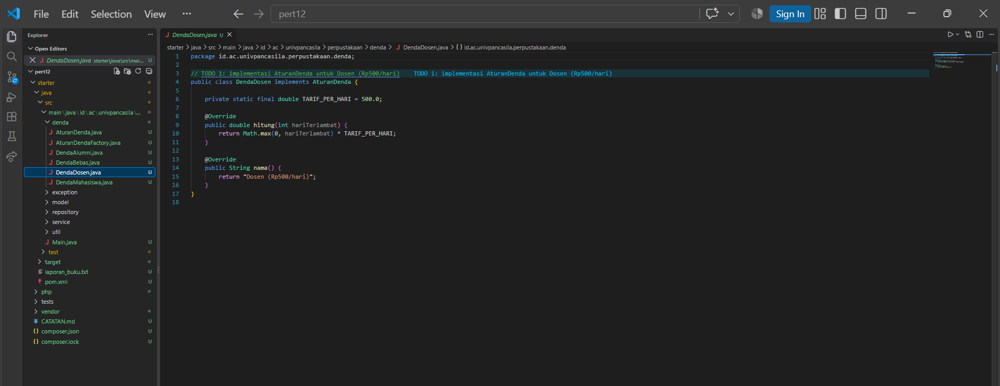

### 1.5. `DendaBebas.java`

**Penjelasan kode:**

Program baru dibuat (tidak ada kondisi sebelumnya).

Aturan khusus untuk Anggota Kehormatan yang **bebas denda**. Method `hitung()` selalu mengembalikan `0.0` berapa pun hari keterlambatannya, dan `nama()` mengembalikan `Kehormatan (Bebas Denda)`.

**Screenshot sebelum:**

Program baru dibuat, jadi belum ada screenshot sebelum.

**Screenshot sesudah:**

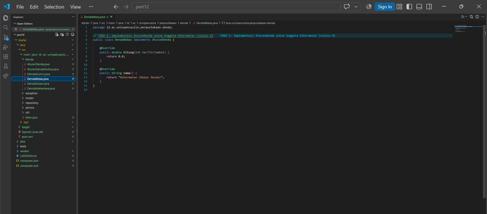

### 1.6. `DendaAlumni.java`

**Penjelasan kode:**

Program baru dibuat (tidak ada kondisi sebelumnya).

Kelas ini adalah bukti **Open-Closed Principle**: sistem terbuka untuk ditambah, tetapi tertutup untuk diubah. Untuk menambah jenis anggota baru (alumni, tarif **Rp750 per hari**), cukup membuat **satu berkas baru** dan menambahkan satu baris `case "alumni"` di factory. Kode lama, termasuk `LibraryService`, tidak perlu disunting sama sekali, jadi risiko merusak fitur yang sudah jalan sangat kecil.

**Screenshot sebelum:**

Program baru dibuat, jadi belum ada screenshot sebelum.

**Screenshot sesudah:**

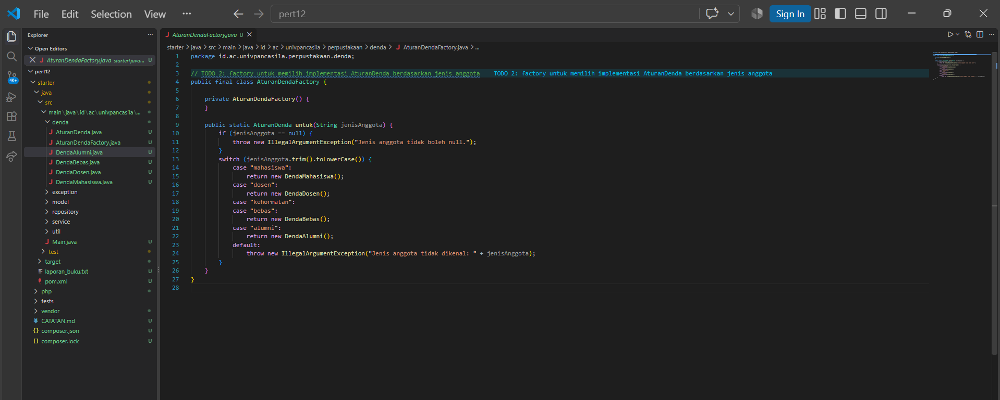

### 1.7. `BookRepository.java`

**Penjelasan kode:**

`BookRepository` adalah *interface* yang berperan sebagai "kontrak gudang buku". `LibraryService` cukup tahu empat hal yang bisa dilakukan gudang ini, tanpa tahu buku disimpan di mana (memori, file, atau database):

- `simpan(Buku buku)` — menyimpan buku.
- `cariByIsbn(String isbn)` — mencari buku lewat ISBN. Hasilnya `Optional`, jadi "tidak ketemu" tidak berupa `null` yang berbahaya.
- `cariSemua()` — mengambil seluruh daftar buku.
- `kurangiStok(Buku buku)` — mengurangi stok saat buku dipinjam.

Hanya method yang benar-benar dipakai yang dimasukkan. Menambah method yang tidak dipakai akan melanggar *Interface Segregation Principle*.

**Screenshot sebelum:**

Interface masih kosong. Isinya hanya komentar TODO 1 beserta saran method yang perlu dibuat.

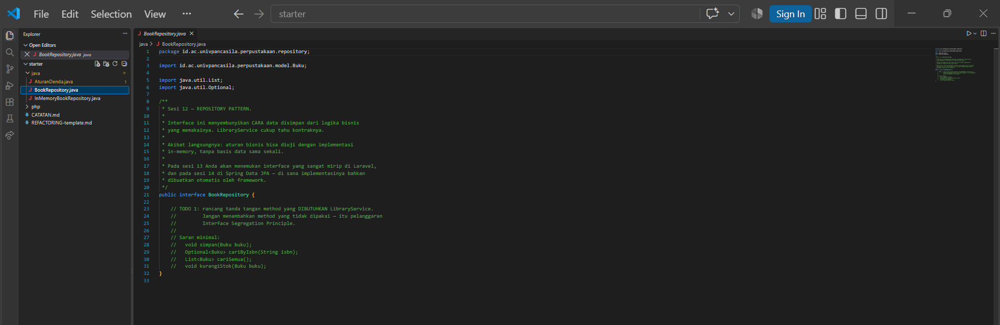

**Screenshot sesudah:**

Keempat method (`simpan`, `cariByIsbn`, `cariSemua`, `kurangiStok`) sudah ditulis tanda tangannya.

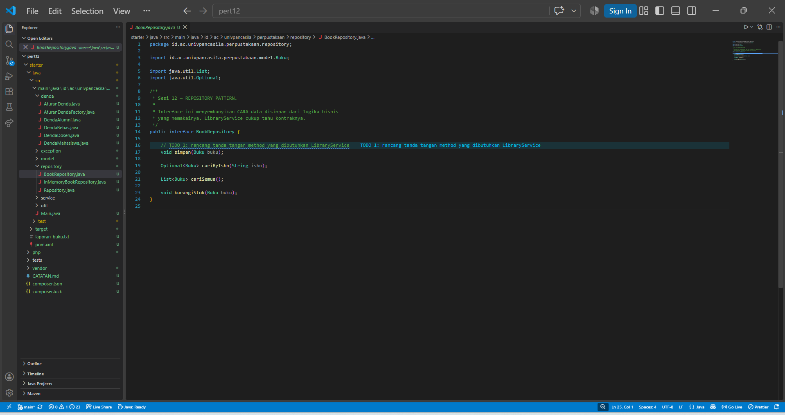

### 1.8. `InMemoryBookRepository.java`

**Penjelasan kode:**

Ini adalah "gudang" yang sebenarnya, yaitu implementasi `BookRepository` yang menyimpan buku di memori komputer (`LinkedHashMap`, dengan ISBN sebagai kunci). Cocok untuk latihan dan pengujian karena tidak butuh database. Isi tiap method:

- `simpan()` — menolak buku `null`, lalu menyimpan buku dengan nomor induk (ISBN) sebagai kunci.
- `cariByIsbn()` — mengembalikan `Optional.empty()` bila ISBN `null` atau tidak ditemukan, selain itu `Optional` berisi buku.
- `cariSemua()` — mengembalikan salinan daftar yang **tidak bisa diubah** (`unmodifiableList`), jadi data asli di dalam gudang aman dari perubahan di luar.
- `kurangiStok()` — menolak buku `null`, lalu memanggil `buku.kurangiStok()`.

**Screenshot sebelum:**

Kelas baru berisi kerangka `LinkedHashMap` dan komentar TODO 1. Belum ada satu pun method yang diimplementasikan.

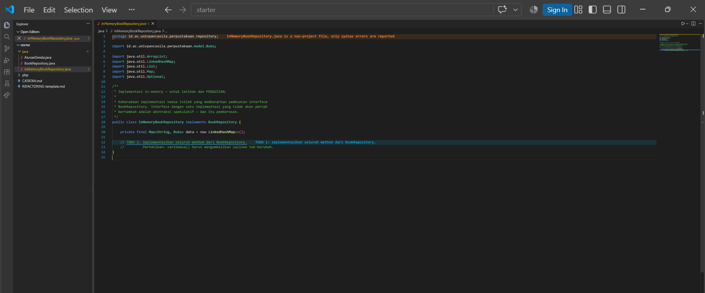

**Screenshot sesudah:**

Keempat method sudah terisi lengkap.

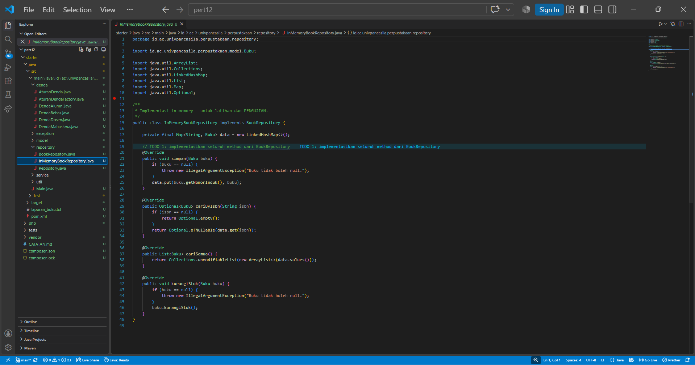

### Output Java

Program dijalankan dengan `mvn exec:java`. Output memperlihatkan menu utama dengan tulisan **"Aturan denda aktif: Mahasiswa (Rp1.000/hari)"**, hasil kerja `AturanDendaFactory` dan `DendaMahasiswa`. Lalu dicoba dua hal:

- Peminjaman dengan ID Anggota `1` dan ISBN `231`: gagal dengan pesan `[Error Domain] Anggota dengan ID 1 tidak ditemukan`, karena anggota belum didaftarkan. Ini menandakan penanganan error tetap berfungsi setelah refactoring.
- Tambah buku dengan ISBN `4525210057`, judul `PRevansyah sjafar`, penulis `14`, dan 2 eksemplar. Program menampilkan `BERHASIL: Buku 'PRevansyah sjafar' (2 eksemplar) ditambahkan.`, lalu kembali ke menu utama.

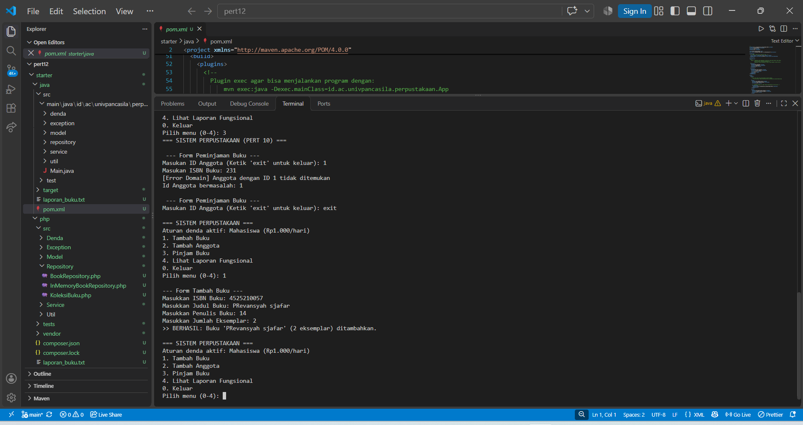

---

## 2. Implementasi PHP

Program PHP memakai namespace `Perpustakaan\Repository` untuk kelas penyimpanan dan `Perpustakaan\Model` untuk kelas data. Konsep refactoring-nya sama dengan versi Java: logika penyimpanan buku dipisah ke *interface* `BookRepository` supaya `LibraryService` tidak bergantung pada cara data disimpan. Pada kerangka awal, semua kelas masih tergabung dalam satu berkas `repository.php`. Setelah refactoring, kelas-kelas itu dipecah menjadi berkas sendiri di folder `src/Repository`.

### 2.1. `BookRepository.php`

**Penjelasan kode:**

Interface `BookRepository` versi PHP, kontraknya sama dengan versi Java:

- `simpan(Buku $buku): void` — menyimpan buku.
- `cariByIsbn(string $isbn): ?Buku` — mencari buku; tanda `?` berarti hasilnya bisa `null` bila tidak ditemukan.
- `cariSemua(): array` — mengambil semua buku (didokumentasikan sebagai `Buku[]`).
- `kurangiStok(Buku $buku): void` — mengurangi stok buku.

Baris `declare(strict_types=1)` membuat PHP ketat soal tipe data, sehingga salah tipe langsung ketahuan.

**Screenshot sebelum:**

Seluruh kode masih tergabung dalam satu berkas `repository.php`: interface `BookRepository` (isinya hanya komentar TODO 1), kelas `InMemoryBookRepository` kosong (TODO 2), interface `AturanDenda`, dan kerangka `LibraryService` (TODO 3–6).

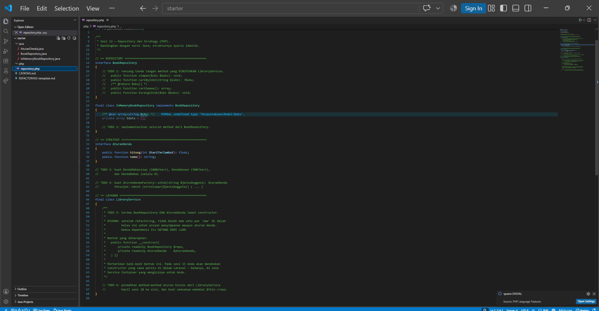

**Screenshot sesudah:**

Interface dipisah menjadi berkas `BookRepository.php` di folder `src/Repository`, dengan keempat method sudah ditulis.

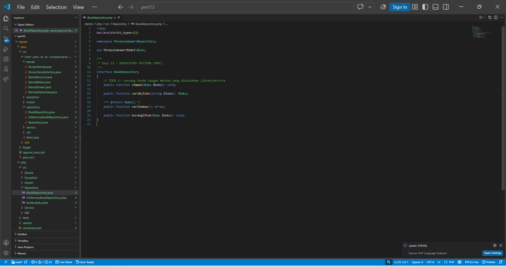

### 2.2. `InMemoryBookRepository.php`

**Penjelasan kode:**

Implementasi `BookRepository` yang menyimpan buku di array PHP (`$data`) dengan ISBN sebagai kunci. Kelas ini `final` (tidak diwariskan lagi). Isi tiap method:

- `simpan()` — memasukkan buku ke array dengan kunci nomor induk (ISBN).
- `cariByIsbn()` — mengambil buku lewat ISBN; bila tidak ada, hasilnya `null` (memakai operator `??`).
- `cariSemua()` — mengembalikan semua buku dalam array berurutan lewat `array_values()`.
- `kurangiStok()` — memanggil `$buku->kurangiStok()`.

**Screenshot sebelum:**

Kelas ini masih berada di dalam `repository.php` dan kosong. Hanya ada properti `$data` dan komentar TODO 2.

**Screenshot sesudah:**

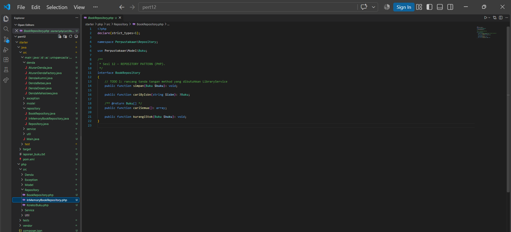

---

### Output PHP

Program dijalankan dengan `php main.php`. Output terdiri dari tiga bagian:

- **Simulasi peminjaman.** `A-001` berhasil meminjam ISBN `111`, sedangkan `A-002` gagal karena bukunya sedang dipinjam. Peminjaman ISBN `999` gagal karena buku tidak ditemukan, dan anggota `X-999` gagal karena tidak terdaftar. `A-001` berhasil meminjam ISBN `222` dua kali, lalu gagal pada percobaan berikutnya karena sudah mencapai batas 3 buku.
- **Laporan fungsional.** Menampilkan daftar buku tersedia (Bumi Manusia, sisa 3), gabungan semua judul buku, dan jumlah buku per penulis.
- **Ekspor laporan.** Daftar buku disimpan ke `laporan_buku.txt` dan berkas ditutup dengan aman lewat blok `finally`.

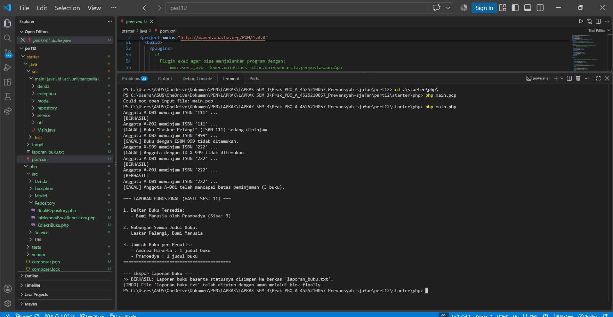

---